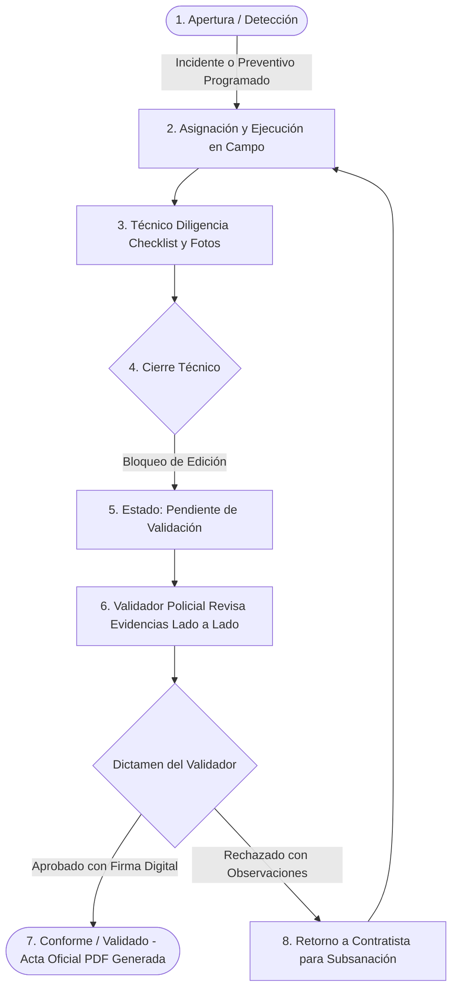

# 📖 Manual de Usuario y Guía Operativa Integral
## Sistema de Gestión de Incidentes y Mantenimiento CCTV Territorial

---

## 📑 Tabla de Contenido
1. [Introducción y Propósito del Sistema](#1-introducción-y-propósito-del-sistema)
2. [Requisitos de Acceso y Entorno Tecnológico](#2-requisitos-de-acceso-y-entorno-tecnológico)
3. [Estructura de Roles y Matriz de Permisos (RBAC)](#3-estructura-de-roles-y-matriz-de-permisos-rbac)
4. [Flujo Operativo General del Ciclo de Vida](#4-flujo-operativo-general-del-ciclo-de-vida)
5. [Guía Detallada Pantalla por Pantalla](#5-guía-detallada-pantalla-por-pantalla)
   - [5.1 Portal de Acceso Institucional y Selección de Sede](#51-portal-de-acceso-institucional-y-selección-de-sede)
   - [5.2 Modo Demostración (Sandbox Interactivo)](#52-modo-demostración-sandbox-interactivo)
   - [5.3 Actualización Obligatoria de Credenciales y Firma Digital (Primer Ingreso)](#53-actualización-obligatoria-de-credenciales-y-firma-digital-primer-ingreso)
   - [5.4 Panel de Control Ejecutivo (Dashboard & KPIs)](#54-panel-de-control-ejecutivo-dashboard--kpis)
   - [5.5 Gestión de Incidentes Técnicos y Correctivos (Tickets & SLA)](#55-gestión-de-incidentes-técnicos-y-correctivos-tickets--sla)
   - [5.6 Plan Maestro de Mantenimiento Preventivo y Proactivo (Checklists & RCA)](#56-plan-maestro-de-mantenimiento-preventivo-y-proactivo-checklists--rca)
   - [5.7 Centro de Validación Técnica Policial y Emisión de Actas](#57-centro-de-validación-técnica-policial-y-emisión-de-actas)
   - [5.8 Inventario de Equipos e Infraestructura CCTV](#58-inventario-de-equipos-e-infraestructura-cctv)
   - [5.9 Centro de Estadísticas, Informes Ejecutivos y Exportación PDF](#59-centro-de-estadísticas-informes-ejecutivos-y-exportación-pdf)
   - [5.10 Administración de Usuarios y Firmas Digitales (Exclusivo Admin)](#510-administración-de-usuarios-y-firmas-digitales-exclusivo-admin)
   - [5.11 Control de Licenciamiento Criptográfico Territorial](#511-control-de-licenciamiento-criptográfico-territorial)
6. [Preguntas Frecuentes (FAQ) y Solución de Problemas Comunes](#6-preguntas-frecuentes-faq-y-solución-de-problemas-comunes)

---

## 1. Introducción y Propósito del Sistema

El **Sistema de Gestión de Incidentes y Mantenimiento CCTV** es una plataforma web integral, robusta y soberana diseñada para la supervisión técnica, control de inventario, mantenimiento predictivo/preventivo/correctivo y auditoría policial de circuitos cerrados de televisión en **4 Municipios Oficiales**:
1. 🏛️ **San Agustín (Huila)**: Circuito Arqueológico, Terminal y Red Hospitalaria.
2. 🏢 **San José del Guaviare (Guaviare)**: Central Departamental, Parque Santander, Muelle Fluvial y CAD Central.
3. 🌳 **El Retorno (Guaviare)**: Circuito Municipal, Vía Nacional, Alcaldía y Polideportivo.
4. 🚤 **Calamar (Guaviare)**: Circuito Fronterizo Fluvial, Muelle Principal y Casco Urbano.

### Pilares Fundamentales
- **Almacenamiento 100% Local y Soberano**: Todas las evidencias fotográficas (antes y después), actas y firmas digitales se almacenan internamente en el servidor (`static/uploads/`), sin depender de nubes de terceros ni exponer datos sensibles de seguridad ciudadana.
- **Ciclo de Validación Inmutable**: Ninguna orden técnica puede darse por cerrada unilateralmente por el contratista. Requiere revisión, dictamen formal y firma digital de la Policía Nacional (Validador).
- **Control Territorial Multi-Sede**: Segmentación estricta de equipos, novedades y técnicos por municipio.

---

## 2. Requisitos de Acceso y Entorno Tecnológico

### Requisitos de Hardware y Estación de Trabajo
- **Dispositivo**: Computador de escritorio, portátil o tablet con pantalla de resolución mínima recomendada de $1280 \times 720$ px (óptimo Full HD $1920 \times 1080$ px).
- **Navegador Web Compatible**: Google Chrome, Mozilla Firefox, Microsoft Edge o Apple Safari (versiones actualizadas con soporte para JavaScript ES6 y Canvas HTML5).
- **Periféricos opcionales**: Mouse, pantalla táctil o lápiz óptico para la captura fluida de firmas digitales.

### Requisitos de Conectividad y Red
- Conexión a la red local (LAN), VPN institucional o enlace seguro a la dirección IP o dominio donde resida el servidor (por defecto en local: `http://127.0.0.1:8000`).
- No se requiere acceso a Internet público para las operaciones cotidianas de CCTV, a excepción de la verificación DNS en la creación de correos de usuarios cuando la política corporativa esté habilitada.

---

## 3. Estructura de Roles y Matriz de Permisos (RBAC)

El sistema opera bajo un modelo estricto de **Administrador Principal Único** complementado por tres (3) perfiles operativos bien delimitados:

| Característica / Módulo | 👑 Administrador Principal | 🔍 Validador (Policía Nacional) | 🛡️ Supervisor(a) del Contrato | 👷 Empresa de Mantenimiento |
|---|:---:|:---:|:---:|:---:|
| **Número permitido en el sistema** | **Exactamente 1** | Múltiples (por sede y placa) | Múltiples | Múltiples (técnicos de campo) |
| **Inicio de Sesión y Dashboard** | ✅ Total | ✅ Sede Asignada | ✅ Sede Asignada | ✅ Sede Asignada |
| **Apertura de Incidentes Técnicos** | ✅ Sí | ✅ Sí | ✅ Sí | ✅ Sí |
| **Ejecución y Cierre Técnico en Campo** | ✅ Sí | ❌ No | ❌ No | ✅ Sí (obligatorio fotos y checklist) |
| **Programación de Mantenimientos** | ✅ Sí | ❌ No | ❌ Solo Lectura | ✅ Sí |
| **Dictamen de Conformidad Policial** | ✅ Auditoría | ✅ **Exclusivo (Dictamen & Firma)** | ✅ Supervisión | ❌ No (bloqueado) |
| **Emisión y Descarga de Actas PDF** | ✅ Sí | ✅ Sí | ✅ Sí | ❌ Solo consulta |
| **Gestión de Inventario (Equipos)** | ✅ Total (Crear, Reubicar, Borrar) | 👁️ Visualización | 👁️ Visualización | 👁️ Visualización |
| **Gestión de Usuarios y Firmas** | ✅ **Exclusivo** | ❌ Sin Acceso | ❌ Sin Acceso | ❌ Sin Acceso |
| **Activación de Licencias HMAC** | ✅ **Exclusivo** | ❌ Sin Acceso | ❌ Sin Acceso | ❌ Sin Acceso |

---

## 4. Flujo Operativo General del Ciclo de Vida



---

## 5. Guía Detallada Pantalla por Pantalla

### 5.1 Portal de Acceso Institucional y Selección de Sede
- **Ruta de Acceso**: `/` o `/login`
- **Elementos de la Pantalla**:
  1. **Selector de Municipio / Sede Territorial**: Menú desplegable con las 4 sedes oficiales.
  2. **Selector de Perfil**: Menú interactivo con los roles del sistema (Administrador, Validador, Supervisor, Empresa de Mantenimiento).
  3. **Campos de Credenciales**: Campo de correo electrónico corporativo y contraseña con botón para visualizar/ocultar caracteres.
  4. **Enlace "¿Olvidó su contraseña? Solicite una temporal"**: Abre un modal seguro para solicitar un código de acceso temporal vía correo con vencimiento de 72 horas.
  5. **Botón "Ingresar al Sistema"**: Envía el formulario cifrado mediante token JWT en cookies HttpOnly seguras.

---

### 5.2 Modo Demostración (Sandbox Interactivo)
- **Ruta de Acceso**: Tarjeta derecha en `/` o `/demo/login`
- **Propósito**: Permite realizar pruebas operativas, presentaciones a entidades gubernamentales y capacitaciones sin alterar la base de datos real.
- **Características**:
  - Utiliza una base de datos aislada (`demo_cctv.db`).
  - Botones de acceso directo con 1 solo clic para alternar en cualquier momento entre Administrador, Validador, Supervisor y Mantenimiento.
  - Indicador visual superior con banner ámbar que recuerda que se está en entorno sandbox.
  - Botón "Salir de Demo" para volver instantáneamente a la plataforma oficial.

---

### 5.3 Actualización Obligatoria de Credenciales y Firma Digital (Primer Ingreso)
- **Ruta de Acceso**: `/change-credentials`
- **Condición de Disparo**: Se activa automáticamente cuando un usuario ingresa con contraseña temporal o se le ha asignado la bandera de primer ingreso obligatorio.
- **Componentes**:
  1. **Formulario de Contraseña**: Requiere definir una nueva clave segura (mínimo 8 caracteres) y confirmarla. Se comprueba que no sea idéntica a claves previas.
  2. **Actualización de Correo**: Permite al usuario certificar su buzón electrónico oficial.
  3. **Módulo de Firma Digital Biométrica / Gráfica**:
     - **Modo Trazo (Canvas Interactivo)**: Permite plasmar la firma manuscrita con el ratón o pantalla táctil con botones de limpiar y confirmar trazo.
     - **Modo Carga de Archivo**: Permite subir un archivo PNG o JPG transparente con la firma oficial escaneada.
  4. **Botón "Actualizar Credenciales y Continuar"**: Guarda el hash de la clave, almacena la firma digital como evidencia inmutable y redirige al Dashboard.

---

### 5.4 Panel de Control Ejecutivo (Dashboard & KPIs)
- **Ruta de Acceso**: `/dashboard`
- **Componentes Visuales y Funcionalidades**:
  1. **Banner Semáforo Inteligente de Salud General**:
     - Indica en tiempo real si el sistema se encuentra en estado **Excelente / Operativo** (Verde), **Atención Requerida** (Ámbar) o **Falla Crítica** (Rojo).
     - Muestra el porcentaje de **Disponibilidad Global** del circuito CCTV.
  2. **Banner Pulsante de Validación Policial**:
     - Se ilumina cuando existen órdenes finalizadas por el contratista en espera de dictamen. Muestra el número exacto y cuenta con botón de acceso directo al panel de validación.
  3. **Filtro Rápido por Punto de Monitoreo**:
     - Menú para aislar métricas de puntos específicos (ej. Estación de Policía, Terminal de Transportes, Parque Principal, Vía Nacional).
  4. **Las 4 Tarjetas Estratégicas (Big Numbers)**:
     - **Equipos & Cámaras**: Muestra el total de cámaras activas sobre el inventario y barra de progreso porcentual.
     - **Novedades Activas**: Cuenta de incidentes abiertos, advertencia de fallas críticas y conteo de tickets con SLA vencido.
     - **Mantenimiento Preventivo**: Órdenes programadas, en ejecución y porcentaje de cumplimiento.
     - **Validación de Conformidad**: Conteo de órdenes conformes, pendientes y rechazadas.
  5. **Métricas de Confiabilidad y MTTR**:
     - Indicador del Tiempo Medio de Reparación (MTTR) y cumplimiento contractual de SLA.
  6. **Matriz de Cámaras y Equipos**:
     - Vista conmutativa entre tarjetas visuales con indicadores de estado y tabla condensada con enlaces directos a detalle.

---

### 5.5 Gestión de Incidentes Técnicos y Correctivos (Tickets & SLA)
- **Ruta de Acceso**: `/incidents`
- **Flujo y Acciones**:
  1. **Apertura de Incidente (Botón "+ Nuevo Incidente")**:
     - **Tipo de Falla y SLA**:
       - *Falla Crítica*: Meta de atención de **4 horas**.
       - *Inactivo*: Meta de atención de **12 horas**.
       - *Falla Menor*: Meta de atención de **24 horas**.
       - *Cambio de Equipo*: Meta de atención de **48 horas**.
     - **Punto de Monitoreo y Equipo**: Al seleccionar el punto, el sistema filtra reactivamente los equipos (PTZ, Domo, Switch, etc.) asignados a dicho sector.
     - **Evidencia Inicial**: Carga de fotografía del estado de falla reportado.
  2. **Intervención Técnica en Campo**:
     - El técnico contratista cambia el estado a `En Proceso`.
  3. **Cierre Técnico**:
     - El técnico abre el modal de cierre, describe la **causa raíz**, detalla la **solución técnica aplicada** y sube obligatoriamente la **fotografía de solución**.
     - Al remitir, el ticket pasa automáticamente a `Pendiente de Validación` y su edición se bloquea para el contratista.
  4. **Etiquetas de Resolución SLA**:
     - El sistema calcula con precisión de minutos el tiempo transcurrido:
       - Si se resolvió dentro de la ventana contractual, muestra la insignia **"Resuelto"** (Verde).
       - Si excedió la meta, marca **"Resuelto SLA"** (Ámbar) con el desglose exacto (ej. *Resuelto SLA en 1d 4h*).
  5. **Trazabilidad y Línea de Tiempo**:
     - Modal de auditoría que expone cada cambio de estado, fecha, hora exacta y usuario que ejecutó la acción.

---

### 5.6 Plan Maestro de Mantenimiento Preventivo y Proactivo (Checklists & RCA)
- **Ruta de Acceso**: `/maintenance`
- **Funcionalidades Clave**:
  1. **Programación Técnica (Botón "+ Programar Mantenimiento")**:
     - Definición de periodicidad: Inspección Rutinaria, Preventivo Mensual, Trimestral, Semestral o Anual Integral.
     - Selección de equipo, sede y fecha programada.
  2. **Taxonomía de Confiabilidad y RCA (ISO 14224 / CMMS)**:
     - Registro de factor causal, mecanismo de falla, componente del activo afectado y condición operativa.
  3. **Checklist Técnico en Campo**:
     - Verificación punto por punto: limpieza física de cúpula/óptica, estanqueidad hermética (IP66/IP67), comprobación de voltaje PoE, estado de bancos de baterías UPS, revisión de conectores RJ45 y actualización de firmware.
  4. **Subida de Evidencias (Antes y Después)**:
     - Fotografías del estado de hallazgo previo a la intervención y del equipo completamente operativo tras el servicio.
  5. **Cierre Técnico**:
     - Traslado formal a la bandeja de validación policial.

---

### 5.7 Centro de Validación Técnica Policial y Emisión de Actas
- **Ruta de Acceso**: `/validation`
- **Exclusividad**: Reservado para usuarios con rol **Validador** (Policía Nacional) y Administrador.
- **Pestañas de Trabajo**:
  1. **Por Validar (Pendientes)**:
     - Lista todas las órdenes cerradas por el contratista en espera de dictamen.
     - **Comparador Fotográfico**: Muestra lado a lado la foto del hallazgo inicial versus la foto de la solución técnica.
     - **Acciones Disponibles**:
       - **Validar Conformidad (Aprobar)**: Registra el número de placa policial del oficial, estampa la firma digital, sella la fecha/hora y emite el **Acta Oficial de Conformidad Técnica en PDF**.
       - **Rechazar con Observaciones**: Exige detallar por escrito el motivo de rechazo (ej. *enfoque deficiente, ángulo de visión no coincide, cableado expuesto*), devuelve la orden al contratista para subsanación y reinicia los temporizadores.
  2. **Validados Conformes**:
     - Repositorio histórico con botón directo para descargar e imprimir el Acta Oficial en PDF con sello de conformidad.
  3. **Rechazados**:
     - Historial de órdenes devueltas para control de calidad.

---

### 5.8 Inventario de Equipos e Infraestructura CCTV
- **Ruta de Acceso**: `/devices`
- **Gestión de Dispositivos**:
  - Tipos soportados: Cámaras PTZ, Cámaras Domo Fijo, Cámaras Bala, NVRs (Grabadores), Switches PoE y UPS.
  - Registro de parámetros técnicos: Nombre identificador, marca, modelo, número de serie, dirección MAC, punto de ubicación y dirección IP.
  - **Función de Copiado Seguro**: Al hacer clic sobre cualquier dirección IP o serial, se copia automáticamente al portapapeles con confirmación visual interactiva. Si un equipo no posee IP asignada, se etiqueta limpiamente como `NO APLICA`.
  - **Cálculo Automático de Estado Operativo**:
    - Un equipo se marca en **Falla** (Rojo) automáticamente si tiene incidentes abiertos.
    - Se marca en **Mantenimiento** (Azul) si tiene una orden preventiva en ejecución.
    - Se marca en **Operativo** (Verde) cuando todos sus tickets están solventados.
  - **Acciones Protegidas para Administrador**:
    - **Reubicación de Equipo**: Permite transferir un equipo entre puntos o sedes requiriendo confirmación de clave de administrador.
    - **Eliminación Segura**: Eliminación lógica o física previa confirmación de seguridad.

---

### 5.9 Centro de Estadísticas, Informes Ejecutivos y Exportación PDF
- **Ruta de Acceso**: `/reports`
- **Capacidades**:
  1. **Filtros por Período de Tiempo**:
     - Presets automáticos: Semanal (7 días), Mensual (30 días), Trimestral (90 días), Semestral (180 días), Anual (365 días) o Rango Personalizado con fechas Desde / Hasta.
  2. **Gráficas e Indicadores de Rendimiento**:
     - Curva de disponibilidad del circuito, distribución de fallas por causa raíz, cumplimiento de metas de SLA y efectividad del mantenimiento preventivo.
  3. **Exportación de Informe Ejecutivo en PDF**:
     - Botón superior para generar un documento formal de varias páginas con encabezado institucional, tablas consolidadas, desglose por equipos, resumen de validaciones policiales y espacio para firmas de interventoría.

---

### 5.10 Administración de Usuarios y Firmas Digitales (Exclusivo Admin)
- **Ruta de Acceso**: `/users`
- **Exclusividad**: Solo accesible para el **Administrador Principal Único**.
- **Operaciones**:
  1. **Creación de Nuevo Usuario**:
     - Selección de rol operativo: Validador, Supervisor o Empresa de Mantenimiento (está prohibido crear administradores adicionales).
     - Validación estricta de correo: Verifica en tiempo real la existencia del dominio mediante consulta DNS (registros MX).
     - Placa Policial: Campo obligatorio y único para los usuarios con rol Validador.
  2. **Generación de Credenciales Seguras**:
     - Al crear el usuario, el sistema genera una contraseña temporal de alta entropía y despliega un modal con botones de un solo clic para copiar usuario y clave.
     - Envío automático de notificación por correo electrónico con caducidad de 72 horas.
  3. **Perfil del Administrador y Firma Maestra**:
     - Enlace en la esquina inferior del menú para editar datos del administrador y actualizar su firma digital en el pad interactivo.
  4. **Control de Estado de Cuentas**:
     - Botones para activar, desactivar o eliminar cuentas de usuario.

---

### 5.11 Control de Licenciamiento Criptográfico Territorial
- **Ruta de Acceso**: `/license`
- **Exclusividad**: Administrador Principal.
- **Funcionamiento**:
  - Cada sede territorial cuenta con una clave criptográfica independiente generada mediante algoritmos HMAC-SHA256 y bcrypt.
  - **Período de Gracia (24 horas)**: Al desplegar una sede, el sistema otorga 24 horas continuas de operación libre para configuración y pruebas de campo.
  - **Activación por Años**:
    - Al expirar la gracia o para renovar el ciclo anual, el administrador introduce la clave oficial del Año 1, Año 2 o Año 3.
  - **Protección Antifuerza Bruta**: El sistema bloquea temporalmente los intentos de ingreso de licencia tras fallos consecutivos.
  - **Certificado de Licenciamiento**: Emite constancia digital con el código único de activación territorial.

---

## 6. Preguntas Frecuentes (FAQ) y Solución de Problemas Comunes

### Q1: ¿Por qué no puedo crear otro usuario con rol "Administrador"?
**Respuesta**: Por diseño arquitectónico y de seguridad contractual, el sistema opera bajo la directriz estricta de **Administrador Principal Único**. Esta regla previene conflictos de atribuciones, fuga de privilegios o alteraciones cruzadas en las políticas de seguridad. Si se requiere delegar labores de control, debe asignarse el rol **Supervisor**, y para auditoría técnica, el rol **Validador**.

---

### Q2: ¿Por qué la Empresa de Mantenimiento no puede editar un ticket después de haberlo cerrado?
**Respuesta**: Al registrar la solución y enviar el ticket, este pasa automáticamente a estado **`Pendiente de Validación`**. A partir de ese momento, la orden entra en custodia de auditoría policial para evitar que el contratista modifique diagnósticos, fechas o fotografías con posterioridad. Si se requiere algún ajuste, el Validador Policial debe utilizar la opción **`Rechazar con Observaciones`**, lo cual reabre formalmente el ticket para subsanación.

---

### Q3: ¿Cómo funciona el cálculo de "Resuelto" vs "Resuelto SLA"?
**Respuesta**: Cada tipo de falla tiene una ventana de tiempo máxima contractual:
- **Falla Crítica**: 4 horas.
- **Inactivo**: 12 horas.
- **Falla Menor**: 24 horas.
- **Cambio**: 48 horas.

Si el tiempo total entre la apertura y la validación final es inferior o igual a la meta, el ticket recibe la etiqueta verde **`Resuelto`**. Si superó la meta, el sistema registra transparentemente la etiqueta ámbar **`Resuelto SLA`** e indica los días y horas de exceso para los informes de interventoría.

---

### Q4: ¿Qué debo hacer si olvidé mi contraseña o mi clave temporal de 72 horas expiró?
**Respuesta**:
1. En la pantalla principal de acceso (`/login`), haga clic en el enlace **"¿Olvidó su contraseña? Solicite una temporal"**.
2. Ingrese su correo electrónico registrado.
3. El sistema verificará su identidad y despachará una nueva clave temporal de acceso al buzón oficial.
4. Al ingresar, el sistema le exigirá inmediatamente establecer una contraseña personal definitiva en la pantalla de actualización obligatoria de credenciales.

---

### Q5: Al registrar un usuario, el sistema arroja el error "El dominio del correo electrónico no existe o no tiene registros MX configurados". ¿Qué significa?
**Respuesta**: El sistema incorpora un mecanismo de validación DNS activa para evitar la creación de usuarios con correos inexistentes o mal escritos (ej. `usuario@gmaillll.com`). Asegúrese de que el dominio ingresado sea válido y cuente con servidores de correo operando en Internet.

---

### Q6: ¿Cómo iniciar o detener el servidor en Windows mediante terminal?
- **Para iniciar el servidor**:
  ```powershell
  cd "c:\A. Bodega\Desarrollo de software\Antigravity\Gestión incidentes CCTV"
  .\venv\Scripts\python.exe -m uvicorn app.main:app --host 127.0.0.1 --port 8000 --reload
  ```
- **Para iniciar en Modo Demo**:
  ```powershell
  $env:DEMO_MODE="True"; .\venv\Scripts\python.exe -m uvicorn app.main:app --host 127.0.0.1 --port 8000 --reload
  ```
- **Para detener el servidor**: Presione `Ctrl + C` en la terminal donde se está ejecutando o cierre la ventana del proceso.

---

### Q7: ¿Dónde se guardan físicamente las fotos y evidencias adjuntas?
**Respuesta**: Todas las evidencias se almacenan localmente en la carpeta del proyecto:
`static/uploads/`
Las firmas digitales se guardan en:
`static/uploads/signatures/`
Esto garantiza que ninguna imagen sea transmitida fuera del perímetro institucional del cliente.

---

> ℹ️ **Soporte y Mesa de Ayuda**: Para requerimientos de soporte técnico, renovación de llaves maestras de licenciamiento o consultas de interventoría, comuníquese con el Administrador Principal del Sistema.
